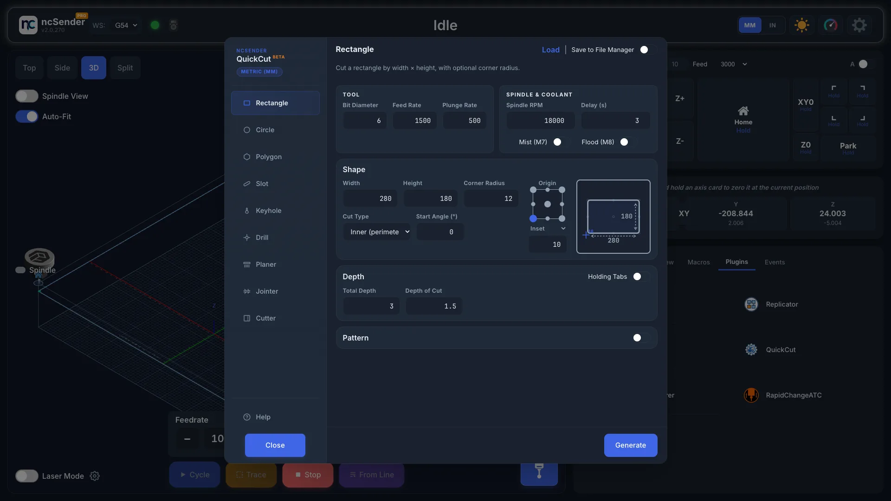
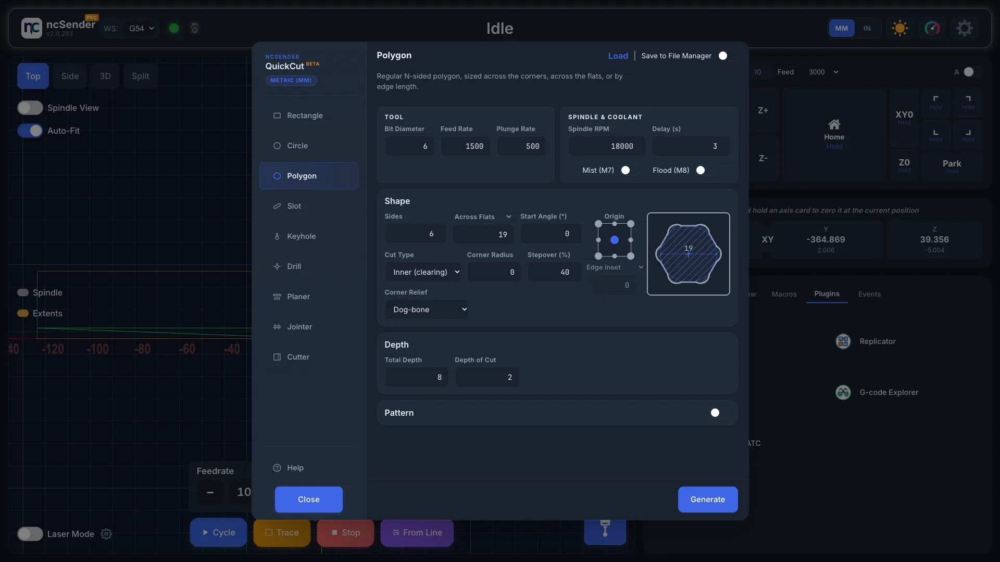
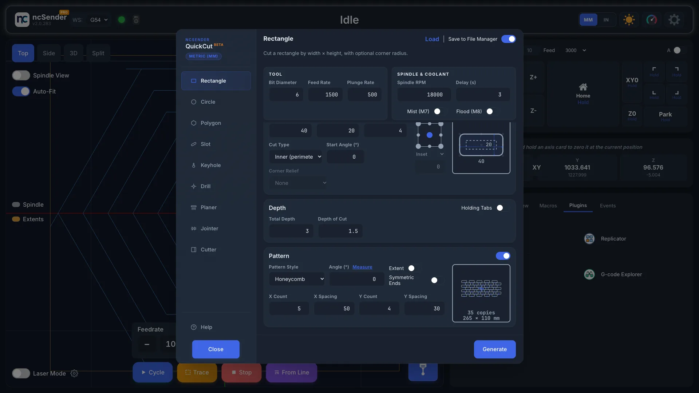
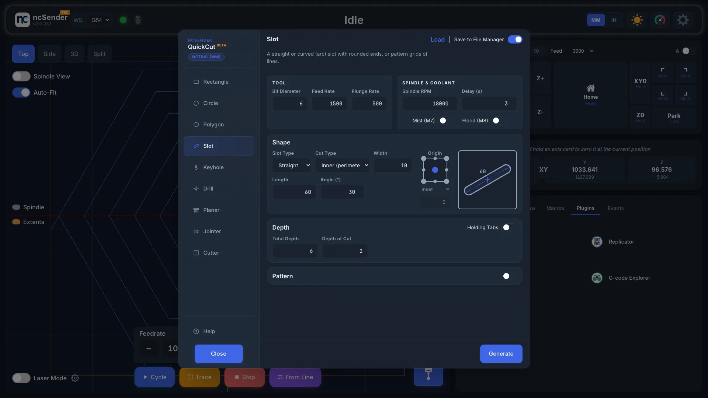
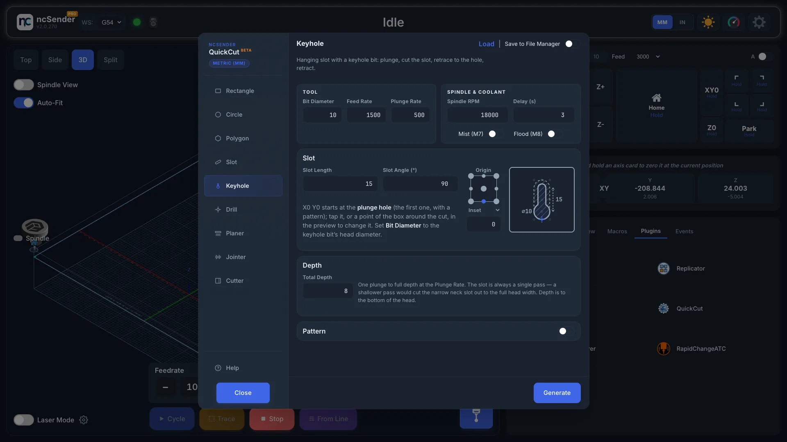
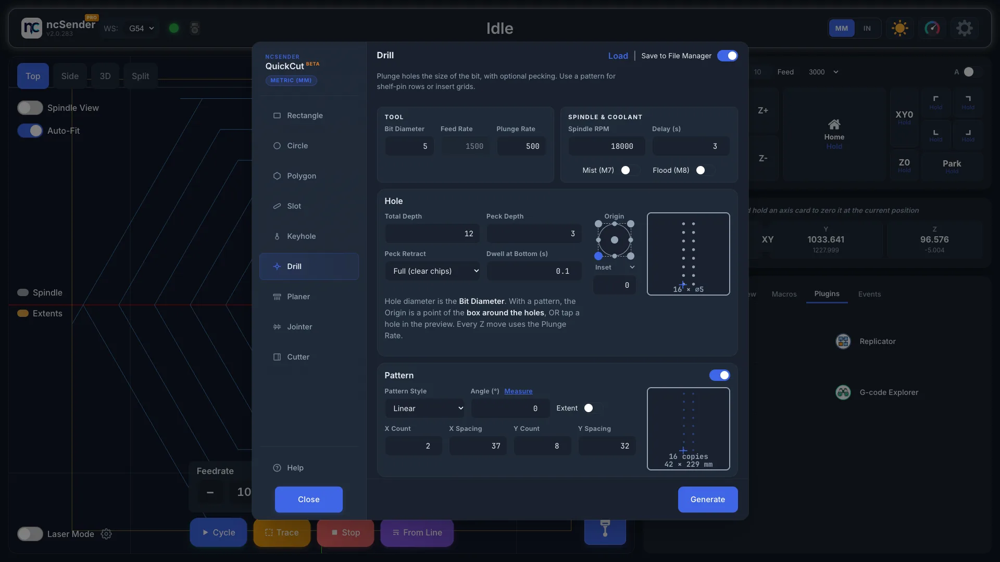
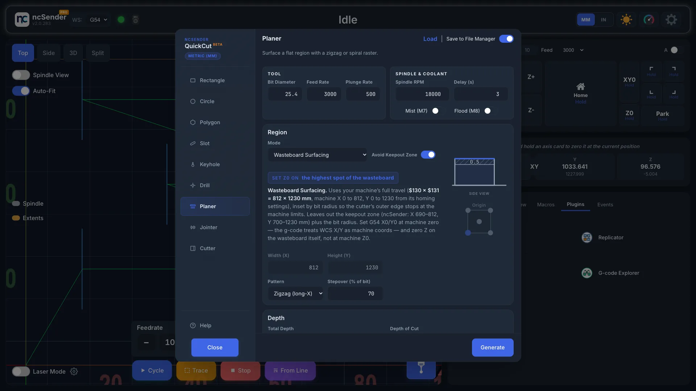
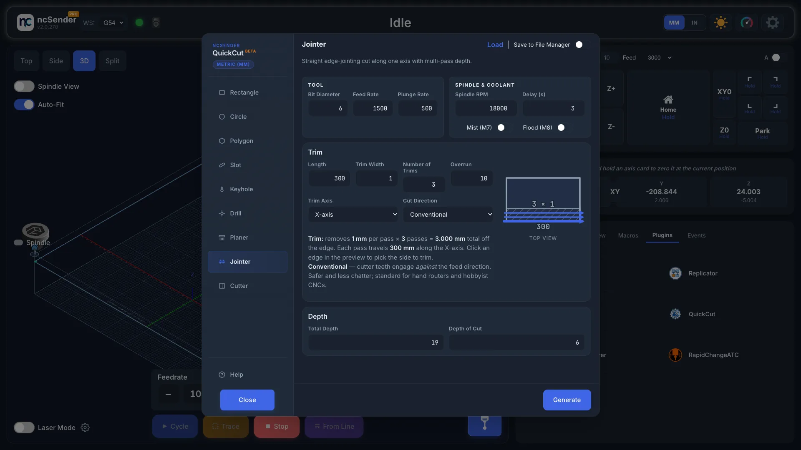
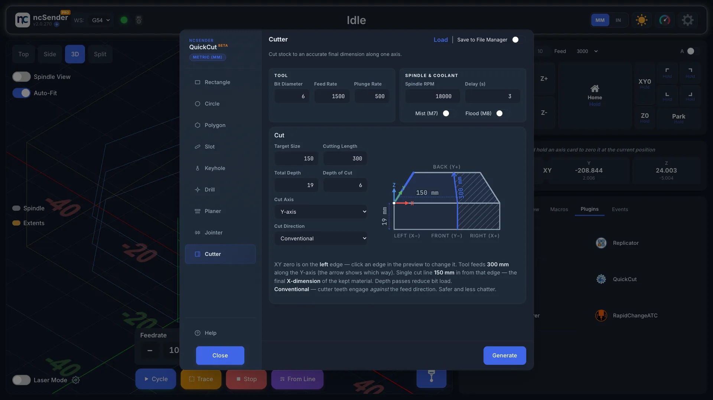

# QuickCut

QuickCut makes G-code for everyday jobs straight from a dialog: cut a
rectangle, circle, polygon or slot, cut a keyhole slot, drill holes, flatten a
board or spoilboard, true up an edge or cut stock to size. Use it when opening
a CAM program for one simple cut isn't worth it.

The dialog title shows **Beta**.

!!! info "QuickCut replaces ToolBench"
    Surfacing, jointing and boring moved here from the retired ToolBench plugin.
    See [Coming from ToolBench](#coming-from-toolbench).

## Make a cut

1. Open the **Plugins** tab in the console area and press **QuickCut**.
2. Pick a tab: **Rectangle**, **Circle**, **Polygon**, **Slot**, **Keyhole**,
   **Drill**, **Planer**, **Jointer** or **Cutter**.
3. Fill in the fields. The preview beside them updates as you type.
4. Press **Generate**.

The dialog closes and the program loads, ready to check in the visualizer and
run. Turn on **Save to File Manager** to also keep a copy in File Manager ›
QuickCut, named after what it cuts, e.g.
`QuickCut-Rectangle_W-120_H-80_D-6_Outer_mm.nc`.

<video autoplay loop muted playsinline preload="metadata" aria-label="Generate a program" poster="../../assets/images/plugins/quickcut-generate-poster.jpg">
  <source src="../../assets/images/plugins/quickcut-generate.mp4" type="video/mp4">
</video>

Each tab remembers its values for next time.

### Load a saved program's settings

Every program QuickCut makes ends with a few comment lines holding the settings
it was made with. Press **Load** at the top of the dialog, pick a program from
File Manager › QuickCut, and QuickCut switches to its tab and fills in those
values. Nothing is generated or run. Sharing a program file shares its setup.

### Help and tooltips

Every field has a tip saying what it is for, shown when you hover over it with
a mouse. On a touchscreen, touch a field and wait a second to see it; the
**Touch Tooltips** switch on the Help page turns this off.

Press **Help** at the bottom of the sidebar for more about the tab you're on,
including every field's tip. The first time QuickCut opens, it starts on the
list of all help topics.

## Settings on every tab

**Tool**

- **Bit Diameter**, **Feed Rate**, **Plunge Rate**.

**Spindle & Coolant**

- **Spindle RPM**.
- **Delay (s)**: how long to wait for the spindle to get up to speed.
- **Mist (M7)** and **Flood (M8)**: turn coolant on for the job.

**Depth**

- **Total Depth**: how deep to cut in total.
- **Depth of Cut**: how deep each pass goes.

QuickCut uses your ncSender units (mm or inches) and your Safe Z height.

**Typing units**

Size, depth and feed fields accept a unit and convert it when you leave the
field: for example `1/4"`, `5/4"`, `1-1/2"`, `.25in` or `6.35mm`, and for
feeds `100ipm`, `2540mm/min` or `25mm/s`. A number with no unit is taken to be
in your ncSender units.

With a keyboard, **Up** and **Down** step a number by 1, with **Shift** by 10,
**Alt** by 0.1 and **Ctrl** by 0.001.

## Shapes: Rectangle, Circle, Polygon

| Shape | Fields |
|---|---|
| **Rectangle** | **Width**, **Height**, **Corner Radius** (0 for sharp corners), **Start Angle (°)** to turn the shape |
| **Circle** | **Diameter**. Circles are cut with a spiral entry and a final clean-up pass. |
| **Polygon** | **Sides** (3 to 12), the size, **Start Angle (°)** to turn the shape, **Corner Radius** (0 for sharp corners) |

A Polygon's size is measured one of three ways; pick it in the menu over the
size: **Across Corners**, **Across Flats** (use this for a hex pocket sized to
a nut) or **Edge Length**. Switching converts the number, so the shape stays
the same.

The preview is drawn to the shape's proportions and shows the corner radius and
angle as you type. Drag on a preview to turn the shape; it snaps to square and
to common miter angles. Click a blank spot on any preview to enlarge it; click
again or press **Esc** to go back.

On an inner cut a corner can't be tighter than the bit's radius. The preview
shows the corner you'll actually get, with the shape as typed dashed, and the
program notes it.

### Cut Type

This decides what is left in the middle.

| Cut Type | What it does |
|---|---|
| **Inner (perimeter)** | Cuts just inside the line. On a through cut the middle falls out as one piece. |
| **Inner (clearing)** | Clears the whole inside, so a pocket comes out flat-bottomed. |
| **Outer (part)** | Cuts just outside the line, freeing the shape from the stock. |

If a hole comes out with a post in the middle, you picked **Inner (perimeter)**
where you wanted **Inner (clearing)**. The preview hatches the area that is
cleared or cut away.

**Stepover (%)** sets how far the bit moves over on each lap when clearing.

### Origin

Pick where work zero sits on the shape with the **Origin** dots: a corner, the
middle of an edge, or the centre. The origin applies to the whole program,
including every copy in a pattern, not just the first shape. A small
crosshair on the preview marks work zero.

You can also tap the preview to put work zero exactly on a point of the shape.
Faint rings mark the points you can tap: the shape's corners (where the edges
meet, even when rounded), the middles of its edges and its centre. This reaches
points the origin dots can't: the corners of a turned rectangle, and the true
centre of an odd-sided polygon. With a pattern, the point is the first copy's.

### Inset

**Inset**, under the Origin dots, keeps the cut a set distance in from a corner
or edge origin without moving work zero. For example, to cut a juice groove
10 mm in from the edge of a 300 × 200 mm board, zero on the board's front-left
corner and cut a 280 × 180 mm Rectangle, **Inner (perimeter)**, Origin
front-left, Inset 10.

- From a corner it moves both ways; from the middle of an edge, only across
  that edge. It doesn't apply to the centre.
- A negative inset moves the cut outward instead.
- Pick **Inset X / Y** in the menu on its label to set the two directions
  separately.
- With a pattern, it applies to the box around all the copies, so a grid can
  start a set margin in from the edges of the stock.

The preview shows the inset as a short dashed line from the crosshair.

### Holding tabs

On **Inner (perimeter)** and **Outer (part)** cuts, turn on **Holding Tabs**
in the Depth header to leave small bridges on the last passes, so the part
can't come loose and catch the bit.

- **Tabs**: how many.
- **Tab Width**: the width of each tab, measured at the part.
- **Tab Height**: how much material is left standing.

Tabs sit in the middle of straight edges. The preview shows where they go. Cut
them free by hand after the job.

### Pattern

Turn on **Pattern** to cut several copies in one program, then pick a
**Pattern Style**. A preview beside the fields shows the whole pattern, the
number of copies and the overall size as you type; drag it to turn the
pattern.

| Pattern Style | Layout | Fields |
|---|---|---|
| **Linear** | Rows and columns | **X Count**, **X Spacing**, **Y Count**, **Y Spacing**. Use a negative spacing to go the other way. |
| **Honeycomb** | Rows shifted by half a step, like a honeycomb | Same as Linear, plus **Symmetric Ends** |
| **Circular (Identical)** | Around a circle, every copy facing the same way | **Count**, **Radius**, **Start Angle (°)**, **Total Angle (°)** |
| **Circular (Path Direction)** | Around a circle, each copy turned to follow the circle | **Count**, **Radius**, **Start Angle (°)**, **Total Angle (°)** |

**Symmetric Ends** drops one copy from each shifted row so both ends of the
honeycomb line up.

**Extent**: turn it on to give the distance from the first copy's centre to
the last instead of the spacing between neighbours. The copies are spread
evenly over it: 5 copies over 400 mm are 100 mm apart.

**Angle (°)** turns Linear and Honeycomb rows, counter-clockwise from +X. At an
angle the fields become **Count**, **Spacing**, **Rows** and **Row Spacing**,
measured along and across the rows. **Rotate shapes** turns each copy with the
rows. Press **Measure** beside the Angle to take it from the machine (see
[Measure an angle](#measure-an-angle)).

**Start Angle (°)** places the first circular copy, counter-clockwise from +X
around the circle's centre. **Total Angle (°)** is the arc the copies are
spread over: 360 spaces them all the way round; less puts the first and last
copy at the ends of the arc; a negative angle runs clockwise. With **Path
Direction**, the first copy looks like the preview and each later copy is
turned by how far round the circle it is.

On the **Circle** tab there is a single **Circular** style, because a turned
circle looks the same.

### Measure an angle

To follow a line on the workpiece that isn't square to the machine:

1. Zero X and Y on a point on the line.
2. Press **Measure** beside the pattern's **Angle**.
3. Type the X and Y of a second point on the same line, or jog there and press
   **Grab Current**.
4. Press **Use** to put the angle in the pattern, or **Back** to leave it.

The point only changes when you type or press **Grab Current**, so jogging
afterwards won't change the angle. It's remembered for next time.

## Slot

Cut a slot with rounded ends: a bolt adjustment slot, a track, or a curved slot
for a tilting table.

- **Slot Type**: **Straight** (set **Length**, end to end, and **Angle**) or
  **Arc**. An arc is set by **Radius**, **Sweep** and **Start Angle**, or by
  **Chord** and **Rise**.
- **Width**: how wide the slot is.
- **Cut Type**: as on the shapes, plus **Center line**, one pass down the
  middle so the slot is the bit's width.

Origin, Inset, Holding Tabs and Pattern work as on the shapes. On the preview
you can also tap an end, a corner or the middle of a long side.

The **Grid** pattern, for straight slots, cuts rows and columns of lines that
span the grid, for example a grid of grooves with the Center line cut.

To round over a stock corner, zero on the corner and cut an Arc: Radius = the
corner radius + the bit radius, Sweep 90, Start Angle facing the corner,
**Center line**, that corner as the Origin, and Inset = minus the bit diameter.
QuickCut's own Help has the full recipe.

## Keyhole

Cut a hanging slot with a keyhole bit, the kind used to hang a sign or picture
on a screw. The bit plunges to full depth, cuts the slot, comes back along it
and lifts out at the hole, since its head can only leave through the hole.

- Set **Bit Diameter** to the bit's head diameter.
- **Slot Length**: from the centre of the hole to the centre of the slot's end.
  The menu on its label switches to **Slot Ratio**, a multiple of the Bit
  Diameter (1.5 to start), so the slot follows the bit when you change it.
  A Slot Length stays as typed. Switching converts the number.
- **Slot Angle (°)**: the direction the slot runs, counter-clockwise from +X.
  90 runs toward the back. You can also drag on the preview to turn the slot.
- **Total Depth**: to the bottom of the head. There's no Depth of Cut: the slot
  is always one pass.

By default work zero is the plunge hole; tap it on the preview to pick it
again. The Origin dots pick a point of the box around the whole cut instead.
In the preview, the solid outline is the keyhole at the surface, and the dashed
outline is the head's path under it. Keyhole works with every pattern.

## Drill

Drill holes the size of the bit, one or a whole pattern of them: shelf-pin
rows, insert grids, pilot holes.

- **Peck Depth**: 0 drills in one plunge. Otherwise each peck goes that much
  deeper.
- **Peck Retract**: **Full** lifts above the surface to clear chips. **Short**
  backs off a little to break the chip.
- **Dwell at Bottom (s)**: a pause at full depth.

Every move is at the **Plunge Rate**, so **Feed Rate** is greyed out on this
tab.

With a pattern, the origin is a point of the box around all the holes, or tap
a hole in the preview to make that hole work zero. Up to 50 × 50 holes are
drawn; larger patterns show the count instead.

## Planer

Flatten an area of stock, or your whole spoilboard.

Pick a **Mode**:

| Mode | Set Z zero on | Use it to |
|---|---|---|
| **Target Depth** | Top of the stock | Take a set amount off the top |
| **Target Thickness** | Spoilboard (bottom of the stock) | Mill the stock down to a finished thickness. Enter the **Starting Thickness**. |
| **Wasteboard Surfacing** | Top of the spoilboard | Flatten the whole machine bed |

**Wasteboard Surfacing** reads your machine's travel from the controller and
covers the whole work area, so there is no size to enter. It works out where
that travel is in machine coordinates from grblHAL's homing settings, so it
suits machines whose coordinates run from 0 up and machines whose coordinates
run negative, the usual grbl setup. The hint under Mode shows the range. If a keepout zone is
on, ncSender Pro's (Settings › Advanced) or an ATCi tool rack's, an **Avoid
Keepout Zone** switch appears beside Mode. With it on, the surfacing leaves
out each zone plus the bit radius and flattens the rest of the bed, lifting to
the safe height before moving across a zone.

For the other modes, set:

- **Width (X)** and **Height (Y)**: the area to flatten.
- **Overrun**: how far past the edges to go, for a clean edge.
- **Origin**: where work zero is on that area.
- **Pattern**: **Zigzag (long-Y)**, **Zigzag (long-X)** or
  **Spiral (outside-in)**.
- **Stepover (% of bit)**.

The side-view picture shows where Z zero is. Check it before you press
**Generate**: Target Depth and Target Thickness measure from opposite faces of
the stock.

## Jointer

Cut a straight, clean edge on rough stock.

- **Side to cut**: tap the edge in the preview: front, back, left or right.
- **Trim Axis**: **X-axis** or **Y-axis**, the direction the edge runs.
- **Length**: how long the edge is.
- **Trim Width**: how much each trim takes off the edge.
- **Number of Trims**: how many trims to take.
- **Overrun**: how far past each end to go.
- **Cut Direction**: **Conventional**, **Climb** or **Both Ways**. Both Ways
  cuts every other trim back the other way, so there is no trip back to the
  start. Tap the arrows in the preview to switch.

The top-view picture shows each trim with an arrow the way the bit travels.

## Cutter

Cut stock to an exact size along one axis. QuickCut allows for the bit width
so the piece you keep is the size you asked for.

- **Cut Axis**: **X-axis** or **Y-axis**.
- **Target Size**: the finished size of the piece.
- **Cutting Length**: how long the cut is.
- **Cut Direction**: **Conventional**, **Climb** or **Both Ways** (each depth
  pass goes back the other way). Tap the arrow in the preview to switch.
- **Origin (start side)**: tap an edge in the preview.

The cut is taken in several passes, set by **Total Depth** and
**Depth of Cut**.

## Coming from ToolBench

QuickCut's Planer, Jointer and Cutter replace the ToolBench operations. Two
things work differently:

- **Boring is now Circle.** A bored hole is a Circle with
  **Inner (perimeter)**. A flat-bottomed pocket, which ToolBench could not make,
  is **Inner (clearing)**. For holes the size of the bit, use **Drill**.
- **Origin covers the whole program.** In ToolBench, a centre origin placed a
  bore pattern evenly around work zero. In QuickCut the origin applies to
  everything generated, pattern included.
